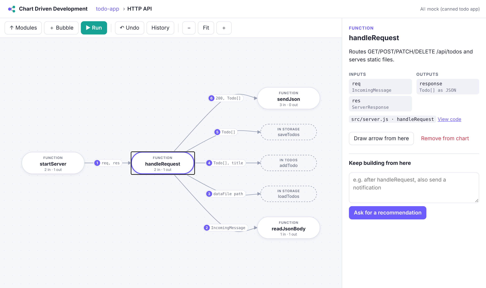

# Chart Driven Development

Build an app by drawing and growing a flowchart. You describe an idea, the AI suggests a tech stack, draws your app as a chart of **modules**, and writes **real code** into a normal project folder. Open a module to see its **function bubbles**. Select any bubble and ask the AI to keep building from there.



## Quick start

```bash
npm install
cp .env.example .env        # put your DEEPSEEK_API_KEY in .env
npm start                   # http://localhost:4317
```

No API key yet? `npm run start:mock` runs the whole flow offline with a canned "todo app" so you can click around.

Requires Node 20+ and git.

## How it works

| You do | What happens |
| --- | --- |
| Type an idea ("todo app") | The AI recommends a tech stack plus alternatives. You pick one. |
| Pick a stack | The AI draws the module chart, then writes scaffolding and each module's code. Every step is a git commit in the generated project. |
| Click a bubble | See its description, inputs, outputs, file and code. |
| Double-click a module | Open its inner chart of functions. Dashed bubbles are functions in other modules; click one to jump there. |
| Select a bubble, type what should happen next | The AI first **recommends how to proceed** (extend / split / rewrite / rewire). Pick an option and it updates the chart and code right away. |
| **＋ Bubble** | Draw a bubble by hand (name, description, optional inputs/outputs). It's a draft until you click **Write the code**. |
| **Draw arrow from here** | Connect two bubbles by hand and name the data that flows. |
| **▶ Run** | The AI invents abstract test data and the chart animates it flowing through the bubbles in call order. |
| **Undo** / **History** | Restore any earlier version (code and chart together). Restores are new commits, so they can be undone too. |
| Edit code in your own editor | The app notices uncommitted changes and offers to read them and update the chart, or keep them without updating. |

Arrows show **both** call order (the number) and the **shape of the data** passed.

## Where things live

- Generated projects: `./projects/<name>/` (change with `CDD_WORKSPACE`). Each one is a normal folder with its own git repo.
- The chart is stored next to the code in `.chart/chart.json`, so it is versioned together with the code.
- The app binds to `127.0.0.1` only. Single user, no accounts.

## Code layout

```
src/shared/      types + chart helpers used by server and browser
src/server/      local HTTP API, project/git/watch logic
src/server/ai/   AI interface, DeepSeek client + prompts (llm.ts), offline mock (mock.ts)
src/client/      browser UI: chart rendering (dagre + SVG), panels, run animation
public/          index.html, styles.css (client bundle builds to public/build)
test/            end-to-end test of the todo demo (mock AI) + LLM output normalization
```

`npm test` runs the tests, `npm run typecheck` type-checks everything.

## Assumptions made for this first version

These weren't specified, so I picked something reasonable. Easy to change.

- **Outside edits** are detected by polling `git status` every 1.5 s while the project is open (the app commits everything it does itself, so anything uncommitted came from outside). This survives editors and git replacing files, which recursive file watching didn't.
- **"Keep, don't update"** on outside edits commits them as-is so the warning goes away.
- **Run** works at the level you're looking at (modules, or a module's functions). It doesn't execute your code.
- **Arrows into other modules** are written as `module-id/function-id` and drawn as dashed "ghost" bubbles.
- **Removing a bubble** removes it from the chart only; its code stays (ask the AI to rewrite if you want code removed).
- The AI always returns **whole files**, not diffs, which is simpler and more reliable with DeepSeek's JSON mode. Very large files may hit the response limit; you'll see a clear error if so.
- Generation makes one AI call for the chart, one for scaffolding and one per module.
- Layout picks left-to-right or top-to-bottom, whichever fits your screen better.
